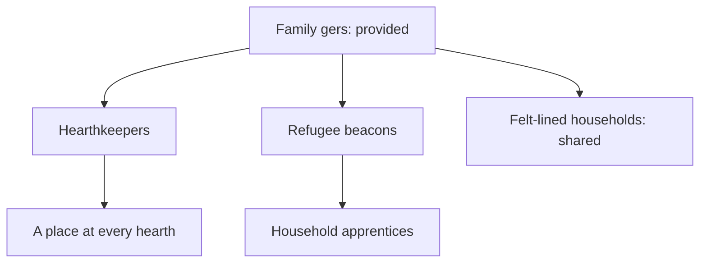
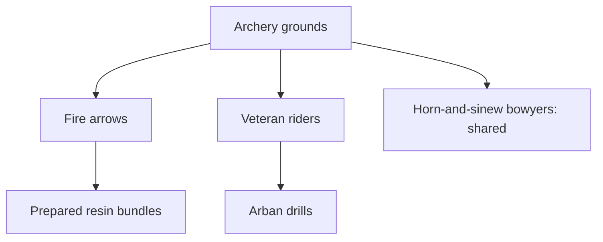
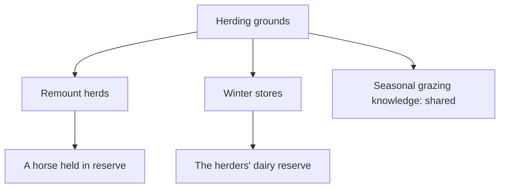
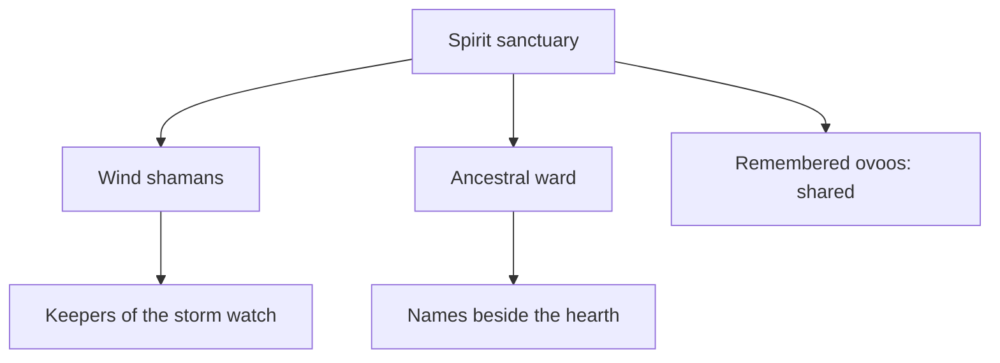
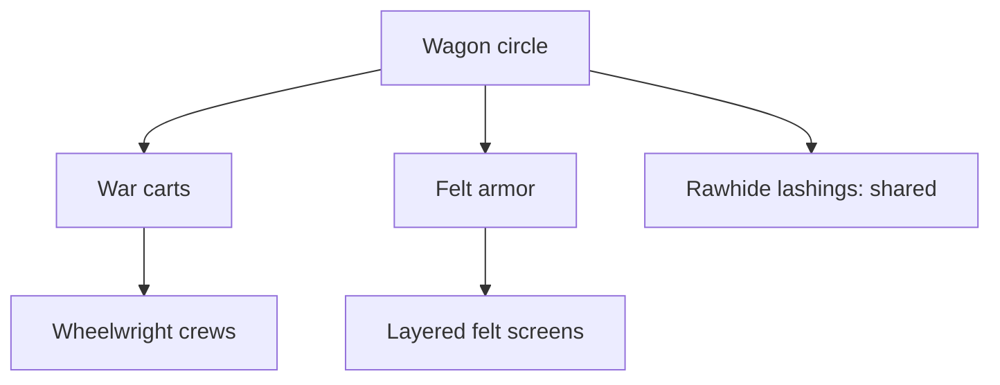
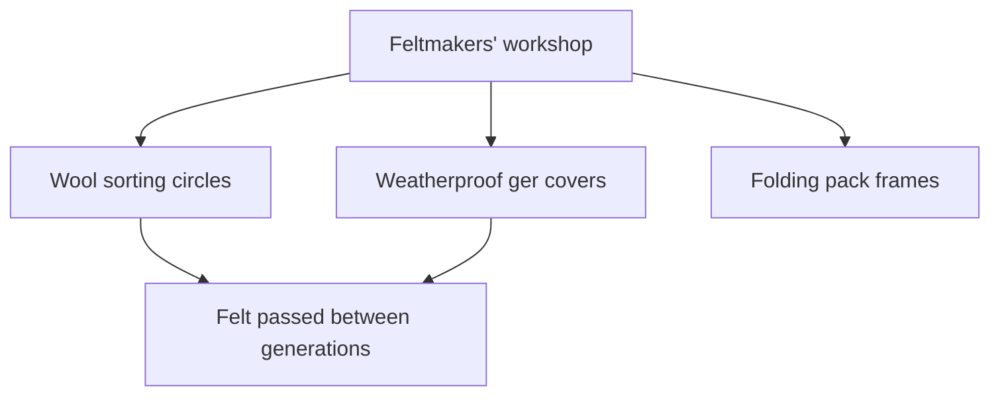
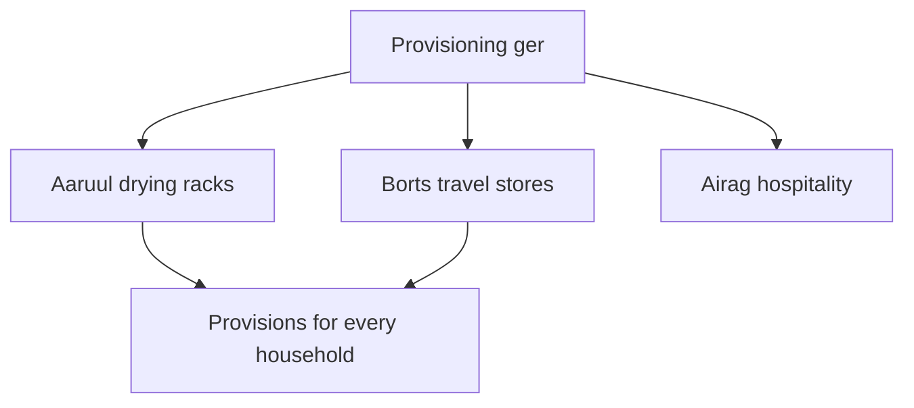
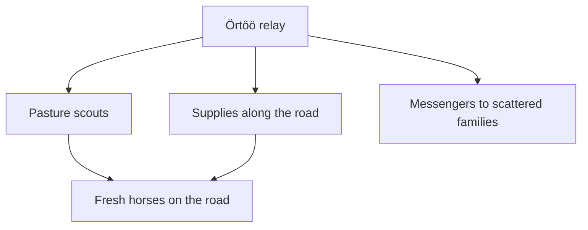

# The travelling camp

The camp has **eight building branches, 37 developments, and 45 visible nodes** including establishment. Its new crafts draw on Mongolian household work, herding, preserved provisions, mounted organisation, and relay travel. Every listed effect below is implemented; the numerical bonuses and supernatural attacks are original game design. [Cultural context and sources](#cultural-context-and-sources) distinguish those adaptations from historical or living practice.

## Purchase and travel rules

Open **B**, controller **X**, or Develop camp. The world pauses. Spend materials, and Spirit where listed; construction reserves workers on establishment. Developments require no extra workers. The starting Family gers are already established. Establishing every other building needs **170 materials, 12 Spirit, and 13 workers** before Guardian discounts. The starting eight people cannot staff everything at once; Hearthkeepers alone can expand the clan to fourteen.

The five original branches retain their **either/or specialization pair**. Their shared craft is independent of that choice, and each specialization has its own deeper development. Choosing one specialization excludes the other and its descendants. The three new branches have complementary crafts; all four developments can be learned. Their final craft requires both named parents, not either parent.

Every node is a one-time purchase. The 37 authored developments include alternatives: at most **27 developments** can be learned together in the current catalog. There is no fixed two-level limit. Resources, effects, staffing, and chosen paths travel through every crossing. Construction waits until the caravan unpacks. New expeditions reset the camp.

All prices below are **individual material prices before discounts**; `+S` indicates additional stored Spirit. Two Guardian foundation ranks apply ×0.81 to each material price, rounded up. Workers and Spirit are unaffected. Percentage effects multiply with other camp upgrades, patron effects, and formations; flat recovery and arrival rewards add. Timers use active gameplay seconds and freeze in menus. “Stationary” includes the final stand.

## Family gers · households and hospitality

**Provided at the start; 0 workers.** The base definition would cost 18 materials and welcome six people, but it cannot be bought again in a normal expedition.

Hearthkeepers and Refugee beacons are exclusive; Felt-lined households can accompany either.

| Development / ID                                | Cost | Requirement     | Effect                                                                            |
| ----------------------------------------------- | ---- | --------------- | --------------------------------------------------------------------------------- |
| Hearthkeepers · `hearthkeepers`                 | 27   | Established     | +6 people immediately; restore 0.25 resolve/second while stationary.              |
| Refugee beacons · `refugee-beacons`             | 27   | Established     | +10 people immediately.                                                           |
| Felt-lined households · `felt-linings`          | 22   | Established     | Clan damage ×0.9.                                                                 |
| A place at every hearth · `hospitality-circle`  | 36   | Hearthkeepers   | Another +0.15 stationary resolve/second; arrivals heal 10 additional Khan health. |
| Household apprentices · `household-apprentices` | 36   | Refugee beacons | Stationary material gathering ×1.2.                                               |

Population is capped at 120. Resolve and Khan recovery respect their maximums. Recovery does not resurrect casualties.

## Archery grounds · bow craft and mounted organisation

**Establish: 24 materials, 3 workers.** Recruit three accompanying riders; unlock Encirclement and Charging wedge.

Fire arrows and Veteran riders are exclusive. Bowyers can accompany either.

| Development / ID                             | Cost | Requirement    | Effect                                                                                              |
| -------------------------------------------- | ---- | -------------- | --------------------------------------------------------------------------------------------------- |
| Fire arrows · `fire-arrows`                  | 36   | Established    | Friendly arrows ignite enemies for 2 seconds, at shared damage ×0.45/second. Hits refresh the burn. |
| Veteran riders · `veteran-riders`            | 36   | Established    | +3 riders; companion arrow multiplier rises from 0.6 to 0.9.                                        |
| Horn-and-sinew bowyers · `seasoned-bowyers`  | 28   | Established    | Khan and companion targeting range +30 world units. Does not extend projectile lifetime.            |
| Prepared resin bundles · `resin-preparation` | 42   | Fire arrows    | Burn damage ×1.3, reaching shared damage ×0.585/second.                                             |
| Arban drills · `arban-drills`                | 42   | Veteran riders | Companion arrow damage ×1.2; mounted-host firing interval ×0.9.                                     |

With Arban drills and Sülde's Rallying banner, veteran rider arrows use `0.9 ×1.2 ×1.25 = 1.35` shared damage. Host haste does not change sanctuary, wagon, water-pulse, or ancestral timers. Living riders remain capped at sixteen; “arban” inspires the coordination upgrade rather than requiring a literal ten-rider squad.

**Burning Tempest** still requires Fire arrows plus Wind shamans. It adds two curving, burning arrows to each friendly volley. Prepared resin strengthens their burn, while Veteran riders rules out that combination.

## Herding grounds · pasture and remounts

**Establish: 20 materials, 2 workers.** +4 horses, +0.65 base food/second before pasture and winter scaling, and Feigned retreat.

Remount herds and Winter stores are exclusive.

| Development / ID                                | Cost | Requirement   | Effect                                                        |
| ----------------------------------------------- | ---- | ------------- | ------------------------------------------------------------- |
| Remount herds · `remount-herds`                 | 30   | Established   | Khan ordinary movement ×1.12; migration mobility ×1.2.        |
| Winter stores · `winter-stores`                 | 30   | Established   | +45 food immediately; food consumption ×0.5.                  |
| Seasonal grazing knowledge · `seasonal-grazing` | 24   | Established   | Pasture depletion ×0.85.                                      |
| A horse held in reserve · `relay-remounts`      | 36   | Remount herds | +3 horses immediately, capped at forty; gallop cooldown ×0.9. |
| The herders’ dairy reserve · `dairy-reserves`   | 32   | Winter stores | +25 food immediately; stationary food production ×1.2.        |

The reserve horse reduces a normal gallop cooldown to 2.7 seconds, or 2.025 with Börte Chino's pursuit practice. Gallop speed and duration stay fixed. Herd increases from camp purchases and routes respect the forty-horse cap.

## Spirit sanctuary · remembrance and the fictional storm

**Establish: 20 materials +12S, 2 workers.** Lightning deals shared damage ×3 around a target every 3.5 seconds, with a 70-unit area radius.

Wind shamans and Ancestral ward are exclusive. The sanctuary's attacks are fantasy; the remembrance crafts do not describe real ritual instructions.

| Development / ID                            | Cost    | Requirement    | Effect                                                                           |
| ------------------------------------------- | ------- | -------------- | -------------------------------------------------------------------------------- |
| Wind shamans · `wind-shamans`               | 30 +18S | Established    | Lightning interval becomes 1.8 seconds; combines with Fire arrows.               |
| Ancestral ward · `ancestral-ward`           | 30 +18S | Established    | Shared damage ×1.5 in radius 125 every 1.2 seconds; clan damage ×0.8.            |
| Remembered ovoos · `ovoo-remembrance`       | 24 +8S  | Established    | Completed crossings restore 6 additional clan resolve.                           |
| Keepers of the storm watch · `storm-watch`  | 40 +18S | Wind shamans   | Lightning interval ×0.85: 1.8 → 1.53 seconds.                                    |
| Names beside the hearth · `ancestral-tales` | 38 +16S | Ancestral ward | Khan recovery +0.15/active second; stationary clan resolve recovery +0.1/second. |

Red Eclipse still multiplies lightning intervals by 1.5, giving 2.295 seconds with Storm watch. Ward timers are independent. The Khan's recovery continues while travelling; resolve recovery waits for a stationary camp. Golomt's regeneration adds to the Khan recovery. Sanctuary and Guardian wards remain separate systems.

## Wagon circle · portable defenses

**Establish: 26 materials, 1 worker.** Fires an arrow every 0.9 seconds within targeting range 520. Arrow damage is shared damage ×1.5 while stationary, or ×0.7 during migration.

War carts and Felt armor are exclusive.

| Development / ID                      | Cost | Requirement | Effect                                                        |
| ------------------------------------- | ---- | ----------- | ------------------------------------------------------------- |
| War carts · `war-carts`               | 39   | Established | Three arrows per volley; retain ×1.5 damage during migration. |
| Felt armor · `felt-armor`             | 39   | Established | Clan damage ×0.5; immediately recover 30 resolve.             |
| Rawhide lashings · `rawhide-lashings` | 26   | Established | Migration mobility ×1.08.                                     |
| Wheelwright crews · `wheelwrights`    | 40   | War carts   | Wagon arrow damage ×1.25, reaching ×1.875 shared damage.      |
| Layered felt screens · `layered-felt` | 38   | Felt armor  | Clan damage ×0.9 again.                                       |

Guardian Watchfires still multiplies the wagon interval by 0.75. All other clan protection multiplies with these defenses. Felt protection against supernatural attacks is a game abstraction, not a historical claim about armor performance.

## Feltmakers’ workshop · household craft

**Establish: 22 materials, 2 workers.** Stationary material gathering ×1.15.

All four developments can be learned together.

| Development / ID                                      | Cost | Requirement                              | Effect                                      |
| ----------------------------------------------------- | ---- | ---------------------------------------- | ------------------------------------------- |
| Wool sorting circles · `wool-sorting`                 | 24   | Established                              | Material gathering ×1.15 again.             |
| Weatherproof ger covers · `weatherproof-covers`       | 28   | Established                              | Food consumption ×0.9, including migration. |
| Folding pack frames · `pack-frames`                   | 28   | Established                              | Migration mobility ×1.1.                    |
| Felt passed between generations · `master-feltmakers` | 42   | Wool sorting **and** Weatherproof covers | Clan damage ×0.9.                           |

Workshop plus sorting gives ×1.3225 materials. With Household apprentices and Etügen's shared labour, total material production reaches `1.15 ×1.15 ×1.2 ×1.25 = 1.98375` before population and pasture. This does not create workers or remove establishment requirements.

## Provisioning ger · preserved food and hospitality

**Establish: 28 materials, 2 workers.** +25 food immediately; stationary food production ×1.15.

All four developments can be learned together.

| Development / ID                                     | Cost | Requirement                       | Effect                                                                    |
| ---------------------------------------------------- | ---- | --------------------------------- | ------------------------------------------------------------------------- |
| Aaruul drying racks · `aaruul-drying`                | 26   | Established                       | +20 food immediately; food consumption ×0.9.                              |
| Borts travel stores · `borts-stores`                 | 28   | Established                       | +15 food on each successful crossing.                                     |
| Airag hospitality · `airag-hospitality`              | 24   | Established                       | Welcome 4 people and restore 10 resolve immediately, respecting caps.     |
| Provisions for every household · `shared-provisions` | 42   | Aaruul racks **and** Borts stores | Arrivals heal 10 additional Khan health and restore 6 additional resolve. |

Aaruul is dried curd, borts preserved meat, and airag a fermented mare's-milk beverage. They remain named practices inside the existing abstract Food resource; there is no new item inventory or separate alcohol meter. The hospitality benefit belongs to welcoming households, not a claim of medicinal or magical effects.

## Örtöö relay · the road ahead

**Establish: 30 materials, 1 worker.** Migration mobility ×1.08.

All four developments can be learned together. This is the fictional clan's courier network, represented by a portable camp dispatch point; it does not imply that historical relay stations moved with a single household camp.

| Development / ID                                       | Cost | Requirement                     | Effect                                                                    |
| ------------------------------------------------------ | ---- | ------------------------------- | ------------------------------------------------------------------------- |
| Pasture scouts · `pasture-scouts`                      | 28   | Established                     | Pasture depletion ×0.9.                                                   |
| Supplies along the road · `supply-caches`              | 32   | Established                     | Each completed crossing grants +10 materials and +8 food.                 |
| Messengers to scattered families · `family-messengers` | 30   | Established                     | Blue-banner rescue arrivals welcome 3 additional people, capped at 120.   |
| Fresh horses on the road · `horse-relays`              | 44   | Pasture scouts **and** Supplies | Each completed crossing grants +1 horse, capped at forty, and +4 resolve. |

With Borts stores, crossing supply rewards add **23 food and 10 materials** before route rewards. These supplies are paid only when a crossing completes, including the third crossing; opening menus, setting off, or replaying story records never pays them again. Failed crossings grant no arrival reward. Family messengers adds people only on the blue-banner route, without adding extra rescued riders. Arrival bonuses do not repeat during the final stand.

## Simulation and extension points

[data/clan.ts](../src/game/data/clan.ts) defines stable IDs, categories, costs, dependencies, exclusive groups, immediate grants, and typed ongoing effects. [config.ts](../src/game/config.ts) holds the new balance values in `GAME.camp`. [state/camp.ts](../src/game/state/camp.ts) creates neutral effect state and applies successful purchases once; [state/clan.ts](../src/game/state/clan.ts) validates purchases and drives economy, protection, transport, and arrival rewards. Combat and recovery consume those effects through the existing scene/patron systems.

The shared progression renderer lays out these additional siblings and tiers without authored coordinates or new slot counts. Camp filters now include Craft and Provisions; accent-insensitive search finds `ortoo` as well as `Örtöö`. The chronicle lists every learned development. The workshop, provisioning ger, and relay have representations using existing local painted props; felt and provisions pack into carts while travelling. See [the progression UI guide](progression-ui.md) for further extensions.

## Cultural context and sources

This is a fantasy synthesis of motifs from different periods and living communities, not a reconstruction of one historical Mongolian camp. Cultural practices vary. The Last Court, Sundering, lightning attacks, numerical buffs, and the exact upgrade dependencies are fictional. Household craft, hospitality, and care of animals remain part of clan survival, rather than becoming a list of supernatural powers.

- **Ger and felt craft:** UNESCO describes shared woodwork, felt making, sewing, portable construction, and learning across generations. These inform the household and workshop branches. [Traditional craftsmanship of the Mongol Ger and its associated customs](https://ich.unesco.org/en/RL/traditional-craftsmanship-of-the-mongol-ger-and-its-associated-customs-00872).
- **Pasture and migration:** UNESCO documents the relationship among herders, livestock, pastures, seasonal movement, and shared knowledge. This informs grazing and scouting. [Mongol nomad migration and its associated practices](https://ich.unesco.org/en/RL/mongol-nomad-migration-and-its-associated-practices-02091).
- **Food preservation:** Mongolia's cultural heritage inventory describes aaruul and dried/preserved meat including borts. These inform provisions, not their numerical yields. [Mongolian traditional food, ICH Links Mongolia](https://mongolia.ichlinks.com/archive/elements/elementsV.do?contentsI18NCd=en-US&elementsUid=13829896147278001210&nation=MN).
- **Airag:** UNESCO describes the fermented beverage, equipment, and associated social customs. This informs the shared-table motif. [Traditional technique of making Airag in Khokhuur and its associated customs](https://ich.unesco.org/en/RL/traditional-technique-of-making-airag-in-khokhuur-and-its-associated-customs-01172).
- **Mounted organisation:** Columbia University's educational account describes units organised around ten and mounted tactics. This informs Arban drills without claiming that the game's sixteen-rider cap models the imperial army. [Chinggis's mastery of organization and military tactics](https://www-1.gsb.columbia.edu/mongols/conquests/conquests_2b.htm).
- **Relays and horses:** AMNH discusses mounted postal way stations and the wider importance of horses. The portable dispatch point and supply rewards are this game's adaptation. [The horse in Mongolian culture](https://www.amnh.org/explore/videos/biodiversity/takhi-mongolian-horse/horse-mongolian-culture).
- **Sacred places:** UNESCO documents particular sacred-site traditions and their community context. Remembered ovoos is an invented clan remembrance, not a prescribed ceremony or a model of ritual efficacy. [Mongolian traditional practices of worshipping the sacred sites](https://ich.unesco.org/en/USL/mongolian-traditional-practices-of-worshipping-the-sacred-sites-00871).
