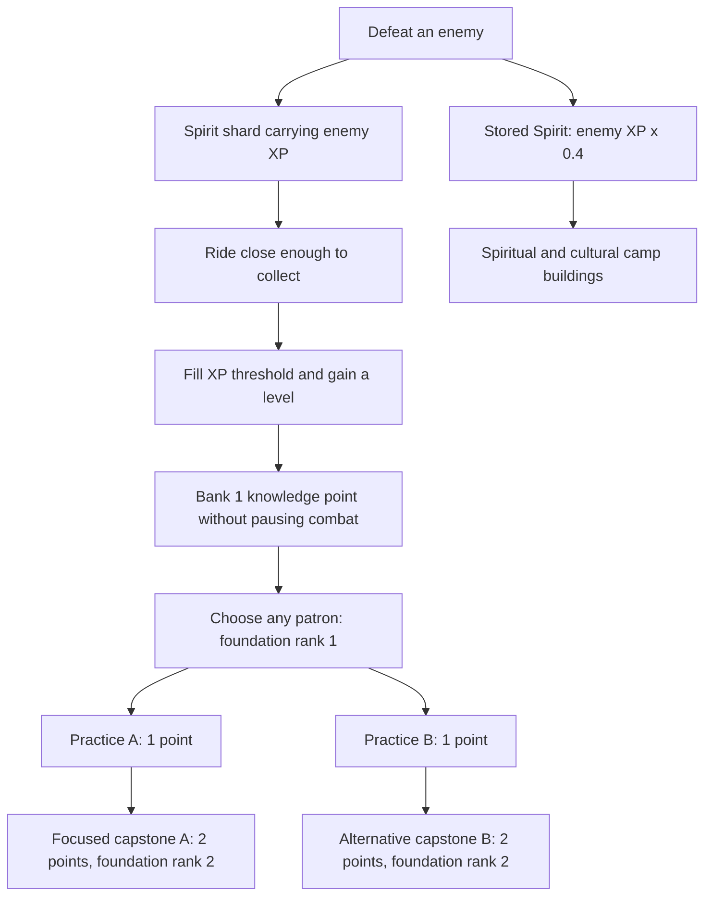

# Hordes of the Fallen Sky — game mechanics brief

This is a reference for the **implemented prototype**, checked against the game code on 25 October 2026. It covers the expedition, resources, combat, spirit progression, camp upgrade tree, migration, enemies, story, and persistence. Values are current balance, not promises for the final release. All times below are active gameplay seconds; menus freeze the world.

## 1. The expedition

The player commands a mounted archer protecting the Blue Banner clan. Ride, dodge, collect spirit shards, develop a travelling camp, and defend three caravan crossings before holding a mountain passage for 180 seconds. The people are the objective: killing the final boss is optional.

The intended rhythm is **build → defend → choose when to leave → escort → rebuild**. A typical expedition targets roughly 15 minutes, but the first three camps have no forced departure time. Leaving early shortens the journey; waiting provides gathering time at the cost of pasture and increasing enemy pressure. There is no global 15-minute victory timer.

The four regions below are journey chapters. The first two crossings can instead
visit any unvisited named destination from the eight-location catalog. Choose the
destination before a river, ridge, or rescue approach. Chapter events and the eight
story beats retain their timing; actual camp names, terrain details, gathering, and
travel modifiers follow the selected location. Food/material multipliers stack with
camp and patron effects, the current camp modifies onward mobility, and the target
modifies incoming crossing duration. All forecasts use those same rules. The third
crossing and final stand remain at the fictional Heart of the Steppe. See
[migration locations](migration-locations.md) for the catalog and cultural sources.

| Stage               | Region / event                            | Rules                                                                                                                                                                   |
| ------------------- | ----------------------------------------- | ----------------------------------------------------------------------------------------------------------------------------------------------------------------------- |
| Act I, camp 1       | The Golden Pasture / The Sundering        | Starting camp. Routes open after 45 seconds. Introductory spawn pacing for the first 18 seconds.                                                                        |
| Crossing 1          | Choose river, ridge, or blue banners      | Automatically moving caravan; no gathering or construction.                                                                                                             |
| Act I, camp 2       | The Silent River / The White Silence      | Food production ×0.7. Migration mobility ×0.8 when leaving this region. Routes open after 45 seconds.                                                                   |
| Crossing 2          | Choose any of the same three routes       | Your build and traditions travel with you.                                                                                                                              |
| Act II, camp 3      | The Broken Pass / The Earth That Walks    | Ground eruptions. Routes open after 45 seconds.                                                                                                                         |
| Crossing 3          | Choose any of the same three routes       | Eruptions continue while travelling through the pass.                                                                                                                   |
| Act II, final stand | The Heart of the Steppe / The Red Eclipse | Hold for 180 seconds. More frequent eruptions; lightning cooldown ×1.5. Skybreaker appears after 20 seconds. No further migration. Camp construction remains available. |

**Victory:** survive the final stand with clan population and resolve above zero, including during Khan succession. **Defeat:** population or clan resolve reaches zero. When the Khan falls, the expedition continues while the clan chooses a successor. No individual companion has a separate health meter.

## 2. Starting state and resources

| Resource / measure | Start                   | Sources                                                                                                                   | Uses and consequences                                                                                                                                                                                                      |
| ------------------ | ----------------------- | ------------------------------------------------------------------------------------------------------------------------- | -------------------------------------------------------------------------------------------------------------------------------------------------------------------------------------------------------------------------- |
| Food               | 70                      | Grazing, camp production, river crossings, story choices, rewards after mastering every tradition                         | Consumed by people, including during migration. Blue-banner rescue costs 18 food on arrival. Zero food triggers starvation checks.                                                                                         |
| Materials          | 50                      | Passive camp gathering, more population, ridge crossings, story choices, rewards after mastering every tradition          | Construct and upgrade camp buildings. No ongoing building maintenance cost.                                                                                                                                                |
| Spirit             | 0                       | Kills grant `enemy XP ×0.4` (×0.5 with Spirit thread); ridge arrival grants 10; some story choices grant 4                | Construct and upgrade spiritual and cultural buildings. Stored Spirit does not buy tradition ranks. It is not consumed by lightning, wards, arrows, or migration.                                                          |
| Spirit shards / XP | Level 1, 0 XP           | Collect drops from defeated enemies                                                                                       | Fill the current level's XP threshold and bank knowledge points for the tech tree. Collection does not deduct stored Spirit.                                                                                               |
| People             | 8                       | Blue-banner arrivals, field rescues, story choices                                                                        | Produce materials, consume food, provide worker capacity. Losses come from starvation and resolve damage. Population gains obey the camp capacity described in [the camp guide](nomadic-camp.md).                          |
| Workers            | 0 assigned of 8         | Existing population                                                                                                       | Construction requires sufficient total population for assigned jobs. Workers are reserved by established buildings, not spent. No manual job reassignment or worker production penalty is simulated.                       |
| Herd / horses      | 3                       | Field rescues (+3); river arrival (+2)                                                                                    | Each horse increases migration mobility by 1.2% of the base. Starvation and clan losses remove livestock. Route rewards cap herd at 40. Herd size does not independently change grazing income or limit rider recruitment. |
| Clan resolve       | 100 / 100               | Communal Hearth, Ancestral Standard, Sülde kills, arrivals (+12), [Skybreaker defeat](final-stand.md), story choices (+5) | Clan-wide survival meter, internally called integrity. Attacks and starvation reduce it; crossing damage thresholds can also cost people and livestock.                                                                    |
| Khan health        | 100 / 100               | Golomt, Börte Chino, arrivals (+25), full recovery after mastering all patrons                                            | Personal health; at zero, choose a new Khan after 10 active seconds while the clan fights on. Enemy contact, hostile shots, and eruptions damage it.                                                                       |
| Pasture            | 100%                    | Refreshed on arrival; Etügen reduces depletion and adds recovery                                                          | Scales food and material production. Without patron bonuses, depletes to zero over 210 stationary seconds, including the final stand. Does not deplete during crossings.                                                   |
| Momentum           | 0–100%                  | Riding builds it; stopping drains it                                                                                      | Improves Khan arrow damage and targeting range; activates moving formation bonuses.                                                                                                                                        |
| Threat             | 0–100%                  | Region and time in the current stage                                                                                      | A pressure indicator. Spawn intervals use their own stage/region formula; the displayed threat value is not an additional damage multiplier.                                                                               |
| Identity           | Iron 0, Sky 0, Wander 0 | Construction, upgrades, route choices, story choices                                                                      | Determines the clan's descriptive identity and epilogue. Grants no additional stat modifiers or technology locks.                                                                                                          |

The opening camp foundations are described in [the nomadic camp guide](nomadic-camp.md). The Khan begins with one accompanying rider, one arrow per personal volley, and no learned traditions.

### Economy and scarcity

`state/economy.ts` supplies the simulation's food/material rates, pasture depletion,
and caravan mobility. Its read-only `economyForecast` estimates active seconds until
food stores empty, integrating changing pasture up to its 0–100% bounds. It holds
population, developments, and regional conditions fixed and assumes no combat losses
or future purchases. Final-stand estimates stop at the passage opening; migration
estimates stop at arrival. `crossingForecast` exposes remaining travel time, food
needed en route, any provision shortfall, and food after the separate arrival reward
or rescue cost. Arrival supplies cannot cover an earlier shortage on the road.

The HUD shows net food per second and the projected time until stores empty, or
whether food lasts to arrival/the final passage. Shortages within 30 active seconds
add a persistent warning, including for large clans with more than 15 food remaining.
The camp Provisions panel displays current production, consumption, net food, and material
rates. Building inspectors preview the actual purchase on an isolated run copy through
`ui/nomadicCampModel.ts` and `state/progressionPreview.ts`. Resource costs may be planned
for, but missing workers, prerequisites, or construction locations still block a preview. Inspection
never spends resources, grants rewards or guidance, or writes to the actual chronicle.
Route estimates show travel time, food consumed before arrival, food after the arrival
transaction, and any en-route shortfall; they never disable a route.

Let `P = pasture / 100`, `N = population`, and `W = 0.7` at Silent River or `1` elsewhere:

```text
Food consumed / second = N × 0.025 × Etügen consumption modifier × camp consumption modifier
Food produced / second while stationary = (0.65 + 0.65 if Herding grounds exist) × P × W × Etügen food modifier × camp food production modifier
Materials produced / second while stationary = (0.28 + N × 0.018) × P × Etügen material modifier × camp material production modifier
Pasture lost / second while stationary = (100 / 210) × Etügen depletion modifier × camp depletion modifier − Etügen recovery
```

Starting production includes the free core buildings’ continuing effects. Production declines with pasture; consumption does not. There is no passive Spirit income, trading, crafting inventory, or individually simulated gathering unit. Population capacity follows the Khan’s Ger level; see [the camp guide](nomadic-camp.md).

During migration, food is consumed but food/material production stops. When food is zero at a 12-second stage-time boundary, starvation removes one person and one horse, records a casualty, and deals 8 raw resolve damage. This can cause an additional resolve-threshold casualty. Checks follow the stage clock rather than a fresh 12-second grace period after food runs out.

Resolve damage multiplies all applicable protection:

```text
Final resolve damage = raw damage
                     × 0.7 with Caravan guard
                     × Guardian patron protection (1 before research)
                     × camp protection modifier
                     × starting-tradition protection modifier
```

Each downward 20-point resolve band crossed by a hit removes one person, capped at the remaining population: a hit from 100 to 80 loses one, to 60 loses two, and to 40 loses three. Count bands after all protection, using resolve clamped at zero; partial damage within a band causes no casualty. A hit crossing any number of bands still removes at most one horse, with herd size floored at zero. Chronicle entries and companion reactions reflect the actual casualties from the hit. Repairs can restore resolve, but do not resurrect casualties.

## 3. Spirit-stone / patron tech tree

Collectible **spirit shards** carry XP; **Spirit** is a separate camp currency earned automatically on kills. Research is expedition progression, with **eight patrons, 42 technologies, and 50 authored ranks (41 learnable ranks after choosing one capstone per patron)**. Patrons can be mixed freely. Their combat abilities are original game mechanics; see [the complete patron tree](patron-tech-tree.md) for every technology, stable ID, exact modifier, and interaction.



The XP threshold from level `L` is `8 + (L − 1) × 6`: 8, 14, 20, 26, 32, and so on. Excess XP carries over; a pickup can earn several levels and every earned point remains banked. Level-ups never open a popup or pause combat. Open the **Patron tech tree** with **T**, controller **LB**, the HUD, Pause, or the chronicle’s Traditions tab. Foundations and practices cost **one knowledge point per rank**. Practices unlock after foundation rank 1. A capstone requires foundation rank 2 and one named practice, and costs **two points**. Choose one capstone per patron; mix practices and patrons freely. A focused route costs five points. There are no random offers or rerolls. Archery has three capstones: precision, piercing, and wide volleys. Repeated percentage modifiers multiply except Lus's two additive slow ranks.

The table below outlines one capstone route per patron; the complete patron catalogue includes every alternative.

| Patron                          | Playstyle                | Foundation → practices → capstone                                                                                    |
| ------------------------------- | ------------------------ | -------------------------------------------------------------------------------------------------------------------- |
| **Börte Chino**                 | Aggressive hunting       | Moving damage and speed → wounded-target damage + shorter gallop cooldown → moving kills heal the Khan.              |
| **Etügen Eke**                  | Sustainable civilisation | Food production and pasture preservation → material gathering + lower food use → pasture recovery offsets depletion. |
| **Khükhedei Mergen**            | Ranged combat            | Shared damage and targeting range → host firing rate + piercing → two additional Khan arrows.                        |
| **Golomt**                      | Survival                 | Maximum health and immediate healing → regeneration + Khan protection → one lethal-hit revival.                      |
| **Lus**                         | Terrain manipulation     | Slowing fields around Khan and camp → larger fields + eruption warning/mitigation → damaging push pulse.             |
| **Ongod**                       | Spiritual summoning      | Two ancestral echoes → stronger echoes + shard attraction/Spirit income → third echo and faster ancestral volleys.   |
| **Sülde**                       | Army leadership          | Two accompanying riders → rider damage + caravan mobility → two more riders and resolve on kills.                    |
| **Guardian of Burkhan Khaldun** | Defensive construction   | Material discounts and clan protection → faster Wagon circle + independent camp ward → further clan protection.      |

The tree opens one connected patron graph with compact navigation, a comparison overview, and an inspector. Search ignores diacritics. Click a node to inspect before/after values, prerequisite routes, costs, and exclusive alternatives; use the explicit Learn button to purchase. Text distinguishes learned, available, prerequisites missing, resources missing, and excluded states. Purchases keep the tree open and preserve focus and scroll. Combinations show existing interactions and link between patron and camp requirements while keeping the world paused. Escape, T, controller B/LB, or the return button closes it with points unspent. Opening from Pause or the chronicle returns to that parent screen. Stored Spirit remains a separate camp currency.

Once all 41 reachable ranks are mastered (excluding capstone alternatives), subsequent points grant **20 food and 15 materials each**, and a living Khan is fully healed when those points are converted. Conversion cannot revive a fallen Khan during succession. Blocked but unlearned technologies do not count as mastery.

Each enemy drops its defined XP independent of scaled health. Shards begin following inside the attraction radius and collect within 18 world units. Once attracted, they keep following. At the 500-shard pool limit, new XP merges into an existing active shard. Uncollected XP travels to the next camp on arrival.

## 4. Camp development and upgrade tree

See [the nomadic camp guide](nomadic-camp.md) for the current building catalog, construction and upgrade rules, inspector controls, costs, effects, and legacy-save migration. The retired craft catalog and its cultural sources remain in [the legacy camp reference](camp-upgrade-tree.md).

## 5. Mounted combat and formations

### Khan, riders, and arrows

The Khan starts with 100 health, 190 movement speed, 16 damage, a 0.6-second firing interval, 85 shard attraction radius, and one arrow per volley. Attacks automatically choose the nearest available enemy within targeting range; there is no manual aim or attack input.

Momentum rises by 0.28/second of actual sustained riding and falls by 1.1/second while stopped, clamped to 0–1. Full momentum takes about 3.57 seconds; sharp reversals reduce it, and pressing into blocked terrain cannot build it. Before research or building upgrades, Khan targeting range is `440 + 120 × momentum`; personal arrow damage is multiplied by `1 + 0.3 × momentum`. Thus full momentum gives 560 targeting range and +30% personal damage.

Accompanying riders each fire one arrow per host volley, at 60% of the shared damage stat before patron and camp modifiers. Their targeting range starts at 440; Khükhedei Mergen adds up to 60 to Khan and rider targeting range. Sülde multiplies rider damage by 1.25; camp escort benefits stack through the ongoing rider-damage modifier. They do not have independent health, consume horses, or reserve extra workers. Total accompanying riders are:

```text
min(16, 1 starting rider
        + starting-tradition riders
        + 3 with Archery Range
        + Sülde rider recruitment (up to 4)
        + 2 per completed blue-banner crossing)
```

Arrows travel at 440 world units/second for 1.6 seconds and normally disappear on their first hit. Khükhedei Mergen unlocks one additional pierced enemy. Each arrow hits a pooled enemy incarnation at most once; its hit history resets on reuse. There are no critical hits. Targeting range determines when a volley is fired, rather than its entire travel distance. The shared projectile pool holds 250 friendly arrows, which can limit very large simultaneous volleys.

### Camp attacks and Burning Tempest

Sacred Ovoo lightning searches within 520 units of the living Khan, then the camp, and deals three times shared damage in a 70-unit radius. Its base interval is 3.5 seconds, or 1.8 with Shaman’s Ger, multiplied by the camp’s sanctuary-interval modifier and by 1.5 during Red Eclipse. The Wagon Yard fires within 520 units every 0.9 seconds, at shared damage ×1.5 while stationary or ×0.7 during migration. These support clocks continue during migration and succession and remain independent of host firing haste.

The building requirements for **Burning Tempest** are listed in [the camp overview](../README.md#build-defend-migrate). Every friendly volley gains two additional arrows, a wider fan and alternating curvature ±0.65 radians/second. Khan, companion, ancestral and wagon arrows participate. Fire-arrow hits apply a two-second burn at shared damage ×0.45 per second, multiplied by the camp burn-damage modifier; hits refresh the timer rather than stacking separate burns.

### Patron support and terrain

Ongod summons up to three visible ancestral riders, separate from the 16 living-rider limit. They follow the Khan, target enemies within 360, and fire every 1.1 seconds (0.77 with their capstone), at 55% shared damage (90% after their practice). They have no individual health or worker cost and freeze with the world in menus.

Lus creates slowing fields around Khan and camp, reaching 24% slow within 230 units at full investment. Its capstone pulses around the Khan every 4 seconds for 75% shared damage and an 80-unit outward push. Its other practice adds one second to eruption warnings and halves eruption damage to Khan and clan.

The Guardian's independent camp ward deals 65% shared damage every 2 seconds, including migration. Its radius starts at 125 and expands with the barricade to keep perimeter attackers in reach. It needs no Sacred Ovoo. Its Watchfires practice reduces the Wagon Yard's firing interval from 0.9 to 0.675 seconds. Full Sülde research restores 0.15 resolve per enemy kill. Support attacks use the same active-time simulation, damage/kill pipeline, and bounded projectile pools as other combat.

### Choosing a new Khan

The player character is **the Khan**. A lethal hit normally starts **10 active gameplay seconds of succession**, marked by **Choosing a new Khan** and a live countdown in the health HUD. This does not change the run to its ended `dead` phase. The fallen Khan is hidden and his collision body is disabled immediately. Riding, galloping, his personal arrows, and shard collection stop; already-fired arrows and burns can finish normally.

The world keeps advancing: enemies attack the camp, food is consumed, the caravan moves, and camp weapons, accompanying riders, and ancestral echoes defend it. Riders and echoes position around camp during succession. The camp's Lus slowing field remains; the Khan's field and damaging pulse are absent. Menus pause the countdown and all other simulation. Camp encounters wait until the new Khan is present.

When the countdown finishes with the clan alive, a successor appears **90 world units below the current camp/caravan center**, at full maximum health with a ready gallop and **3 seconds of invulnerability**. His movement, hit feedback, and attack pose reset. The HUD advances its Khan number. Research, upgrades, max health, resources, workers, buildings, companions, story decisions, and route progress all carry over. The successor follows the current moving caravan or the new regional camp if an arrival happened during succession.

Regeneration, kill healing, immediate healing research, mastery conversion, and arrival healing cannot end succession early. Health upgrades still increase the successor's maximum; food/material rewards still apply. **Last Ember** instead prevents the current Khan's fall immediately, recovering 40% maximum health and consuming its single expedition charge. A successor does not refresh that charge.

Clan population or resolve reaching zero ends the expedition during the countdown. Conversely, completing the final stand saves the clan even while it is choosing a Khan. End screens freeze the remaining timer. A new expedition resets the lineage to Khan 1 with no pending succession. Balance lives in `GAME.khan`, with the pure lifecycle in [state/khan.ts](../src/game/state/khan.ts).

### Gallop

**Space / controller A** gallops in the current or last facing direction at speed 570 for 0.3 seconds, with a 3-second cooldown. Gallop grants invulnerability for its duration. It works from a standstill. Ordinary damage grants 0.65 seconds of invulnerability; getting hit does not reduce clan damage. Charging wedge adds contact damage during gallop. Börte Chino can reduce the cooldown to 2.25 seconds. Golomt reduces Khan damage, provides active-time regeneration, and can prevent one lethal hit per expedition; clan loss still ends the expedition.

### Formation tree

| Formation       | Unlock                   | Positioning and benefit                                                                                                                                        |
| --------------- | ------------------------ | -------------------------------------------------------------------------------------------------------------------------------------------------------------- |
| Caravan guard   | Starting formation       | Riders stay around camp/caravan. All clan damage ×0.7, regardless of Khan distance.                                                                            |
| Encirclement    | Construct Archery Range  | Riders circle an enemy near the Khan, or the Khan if none is nearby. At momentum above 0.5, friendly arrow damage ×1.3, including wagon arrows.                |
| Charging wedge  | Construct Archery Range  | Riders line up behind the Khan. While galloping, enemies within 64 units take `damage stat ×18` per second. This is continuous damage, not one hit per gallop. |
| Feigned retreat | Starting Herding Grounds | Riders spread around the Khan. At momentum above 0.4, host firing interval ×0.7 and shard attraction radius ×1.7.                                              |

Press **F / right bumper** to cycle unlocked formations during play. Effects replace the previous formation's benefit; changing formation has no resource cost or cooldown. Momentum's personal damage bonus and Encirclement's arrow bonus multiply together.

## 6. Migration and arrival rewards

After **45 seconds in each of the first three camps**, press **M** and choose a route. You can close the route panel to stay longer. Every crossing offers the same three routes; routes change rewards, duration, danger, and identity rather than the region order.

| Route                   | Base duration          | Spawn-rate divisor during crossing | Reward / cost on successful arrival                     | Identity  |
| ----------------------- | ---------------------- | ---------------------------------- | ------------------------------------------------------- | --------- |
| Follow the river        | 72 seconds (`60 ×1.2`) | 0.9; fewer spawns                  | +35 food, +2 horses                                     | +2 Wander |
| Ride the high ridge     | 48 seconds (`60 ×0.8`) | 1.5; more spawns                   | +28 materials, +10 Spirit                               | +2 Sky    |
| Answer the blue banners | 60 seconds             | 1.2; more spawns                   | +8 people, +2 rescued riders, −18 food, floored at zero | +2 Iron   |

Actual crossing progress is:

```text
Mobility = (1 + herd × 0.012)
         × (0.8 when leaving Silent River, otherwise 1)
         × Sülde mobility modifier (1.15 with No wagon left behind)
         × camp mobility modifier
         × current-location mobility modifier
         × starting-tradition mobility modifier
Progress = stage time × Mobility / (route base duration × destination crossing modifier)
```

Starting crossing forecasts include the three horses, free core benefits, current location, and destination. Population does not directly slow the caravan, but increases provisions needed. Herd losses can reduce calculated progress because mobility uses the current herd.

The caravan moves east automatically across 1,150 world units as progress reaches 100%. It does not wait for the Khan or depend on remaining within an escort radius. Defend it because nearby enemies and hostile shots damage the clan. You can fight, gallop, change formations, collect shards, and use the tech tree during travel; construction waits for unpacking.

Rewards are not paid when choosing the route. On successful arrival, route rewards apply, the next region begins, pasture resets to 100%, resolve recovers by 12, and Khan health recovers by 25, each capped at its maximum. Buildings, resources, traditions, and riders carry over. Enemies, projectiles, and eruption warnings are cleared; uncollected shards move to the new camp. Arrivals reset the stage clock, not total active journey time.

## 7. Enemies, pressure, and hazards

Enemies choose between Khan and clan: they favor camp when its distance is less than 1.25 times their distance to the Khan. On reaching the barricade, they prioritize attacking it even if the Khan is closer. They stop moving and face the camp, remaining visible and vulnerable until defeated; chargers end their charge at the perimeter. If the caravan leaves their reach, they resume pursuit. Camp threats remain simulated when the player rides away and during succession. Regular enemies far beyond both player and clan can be removed; the Skybreaker persists.

The starting barricade has a 108-unit ground radius, with enemies stopping within 12 units of its visible edge (120 units from the camp centre). The boundary expands in 4-unit increments around household shelters and established building sites, including their ground clearance and the camp's visual scale. Moving or expanding hurdles push encroaching enemies to the outer edge of this attack band, preventing attackers from being covered by tents or the caravan. Each hurdle sorts at its own ground position. Melee and missile impacts brighten and jolt the struck section for 0.24 active seconds; menus freeze this feedback. Wood and cloth show two wear levels below 65 and 30 resolve. During migration, the same bounded pieces become low wheeled screens and move with the caravan; arrival redeploys them and clears old impacts. The barrier shares clan resolve and existing damage protection, with no additional purchase or health pool. The Khan and friendly fire can pass through it.

| Enemy                | Internal ID     | Base health | Speed | Damage | XP / Spirit per kill | Unlock score            | Behavior                                |
| -------------------- | --------------- | ----------- | ----- | ------ | -------------------- | ----------------------- | --------------------------------------- |
| Hollow wolf          | `wisp`          | 25          | 49    | 10     | 3 / 1.2              | 0                       | Melee pursuit                           |
| Winged shade         | `bat`           | 18          | 90    | 8      | 4 / 1.6              | 22                      | Fast melee pursuit                      |
| Earthbound hulk      | `brute`         | 100         | 35    | 18     | 12 / 4.8             | 55                      | Slow, durable melee                     |
| Ghost rider          | `ghost-rider`   | 48          | 112   | 12     | 5 / 2                | 90                      | Charges                                 |
| Hollow seer          | `hollow-seer`   | 65          | 45    | 9      | 7 / 2.8              | 150                     | Ranged                                  |
| Frost mare, elite    | `frost-mare`    | 250         | 82    | 20     | 22 / 8.8             | 210                     | Charges                                 |
| Eclipse giant, elite | `eclipse-giant` | 400         | 34    | 24     | 30 / 12              | 330                     | Ranged                                  |
| Skybreaker, boss     | `skybreaker`    | 3,600       | 42    | 26     | 160 / 64             | Final stand +20 seconds | See [final-stand rules](final-stand.md) |

The seven shared enemies use unlock score `total elapsed seconds + region index ×80`, with region indices 0–3. Unlocks are not fixed real-time timestamps across all runs. The legacy shared-only picker uses weights 6, 3, 2, 3, 2, 1, 1 in the table order. Normal encounter phases mix their shared composition with a 70% preference for eligible natives of the current physical location. Each area has two exclusive local variants; the second enters after 35 active seconds in the stage. Golden Pasture’s first 18 seconds retain introductory wolves. Local types never enter another area’s pool, including when a future destination is being previewed. See [area encounters](area-encounters.md) for all 24 names, terrain rules, abilities and the provisional art contract. Elites join that random pool rather than appear as unique scheduled encounters.

Normal enemy health is multiplied by `1 + total elapsed / 1200`. Boss health stays at 3,600. Movement speed is multiplied by `1 + region index ×0.1`. Base spawn interval is `max(0.14, 0.85 − 0.004 × (stage time + region index ×65))`, divided by route danger during migration. The first 18 seconds in Golden Pasture override the interval to 2 seconds. Afterwards, encounter phase and remaining pasture multiply this base interval (see encounter rhythm below). Rejected placements or a full pool retry after 0.2 active seconds, without banking a burst. Up to 350 enemies may be active; 45% of spawn attempts anchor around camp and the rest around the Khan. During succession, all spawn attempts anchor around camp. In the angled renderer, arrivals use the actual orthographic camera edge and sampled terrain height, then require connected walkable ground and at least 200 units from the living Khan. Terrain-streaming bounds are not spawn bounds. Enemies farther than 1,600 units from both Khan and camp are retired only when also outside the camera’s 640-unit projected arrival margin; visible and approaching enemies survive at wide views. Boss arrival is recorded only after a body is successfully allocated.

Chargers mark a committed direction for 0.8 seconds, move at 2.2× speed for 0.7 seconds, then recover for 1.8 seconds. Terrain and pinning interrupt their charges. Non-boss ranged creatures stop closing within 260 units and fire within 650: by default, one projectile every 3.5 seconds after an initial attack delay. Hostile projectiles move at 125 units/second, last 5 seconds, and damage the Khan for the listed damage or clan for half that raw damage. Shots entering the barricade are consumed at its outer edge and show a local impact. Enemy contact damages the Khan for the listed value. At the barricade, non-boss enemies deal `listed damage ×0.45` raw resolve damage on arrival and every 1.5 active seconds thereafter, subject to their remaining attack cooldown and the clan's usual protection. Menus freeze these attacks and cooldowns. Reaching camp grants no kill, Spirit, or XP reward; defeating the attacker does.

**Ground eruptions:** begin in Broken Pass and persist at the mountain. A warning is placed at the Khan's position with 2 seconds to escape. An eruption deals 20 Khan damage within 70 units and 8 raw clan damage if camp is within 95. The first warning follows an 8-second hazard timer; subsequent warnings occur every 10 seconds in the pass or 6 at the mountain. Gallop invulnerability can protect the Khan, while clan protection follows its usual multipliers.

See [the final-stand rules](final-stand.md) for the Skybreaker's attack cycle, defeat reward, and survival objective.

## 8. Story, clan identity, and chronicle

The five-chapter prologue presents the fictional Sundering and the clan's flight. It appears after **New Game**; completing or skipping it enters the expedition. Replaying the introduction from the title is read-only and returns to the title. With camp scenes enabled, the first encounter opens before combat begins.

Camp scenes are enabled by default and can be toggled at the title. Each encounter pauses combat, physics, economy, and journey clocks, with two choices. Any chosen benefit is granted once: **food +8, materials +6, Spirit +4, or resolve +5**. Each choice also grants **+1** to its associated identity. Escape / controller B skips without a reward. Disabled encounters pass without rewards; disabling camp scenes does not skip the prologue.

| Encounter                 | Trigger                                     | Choice A: gift / identity                            | Choice B: gift / identity                      |
| ------------------------- | ------------------------------------------- | ---------------------------------------------------- | ---------------------------------------------- |
| A place beside the fire   | Expedition begins                           | Share the work: +6 materials / Wander                | Share the watch: +5 resolve / Iron             |
| More mouths, more hands   | First camp reaches 45 seconds               | Prepare the provisions: +8 food / Wander             | Prepare the wagons: +6 materials / Iron        |
| Voices across the ice     | Arrive at first chosen camp                 | Trust the ground: +8 food / Wander                   | Keep the names together: +4 Spirit / Sky       |
| A promise chosen          | Arrive at second chosen camp; Act II begins | We will watch for one another: +5 resolve / Iron     | We will carry every name: +4 Spirit / Sky      |
| When the earth moves      | Second chosen camp reaches 15 seconds       | Mend the wheels together: +6 materials / Iron        | Let the tired hands rest: +5 resolve / Wander  |
| The court's empty promise | Second chosen camp reaches 45 seconds       | Put the tally in shared hands: +6 materials / Wander | Hear the whole account: +4 Spirit / Sky        |
| The narrow opening        | Arrive at Heart of the Steppe               | Organize the last watch: +5 resolve / Iron           | Share a meal before the work: +8 food / Wander |
| Hold the road             | Final stand reaches 90 seconds              | Hold together: +5 resolve / Iron                     | Carry the song forward: +4 Spirit / Sky        |

Dialogue responds to earlier decisions, rescue routes, population, losses, and boss fate. Below five people, encounters use a remnant's collective remembrance instead of a conversation among four named survivors. These are changes to presentation; the same underlying resource and identity choices remain.

The first and second camps above are story positions: Silent River and Broken Pass
are their defaults, with named migration destinations available as alternatives.
Current settings display the chosen place; destination-specific dialogue, revised
display titles, and ending callbacks are proposed in
[the story architecture](../story-architecture.md), rather than implemented here.

Each purchased building level adds **+2 identity** according to its registry doctrine: Military → Iron, Spiritual & cultural → Sky, Core and Economy & survival → Wander. Free core level 1 grants no points. Selecting a route adds +2 of its identity at departure, independently of the delayed arrival rewards.

The strongest identity becomes the clan's name once any score reaches 4:

| Score               | Identity                    | Mechanical effect                      |
| ------------------- | --------------------------- | -------------------------------------- |
| Iron highest        | The Iron Horde              | Descriptive identity and epilogue text |
| Sky highest         | Children of the Eternal Sky | Descriptive identity and epilogue text |
| Wander highest      | The Wandering Nation        | Descriptive identity and epilogue text |
| Every score below 4 | A people taking shape       | No identity declared yet               |

Ties favor Iron, then Sky, then Wander. Identities do not make other buildings or routes unavailable.

**Tab / J** opens the paused clan chronicle: journey, clan/workforce/buildings, traditions, and recorded story. The story tab retains the actual resolved dialogue, selected choice or skip, outcome, time, and population. Pause and result menus also offer **Our remembered road**. Reading records never grants rewards again and returns to the previous paused or ended screen. Story completion preserves banked knowledge points; it does not force a research menu.

With camp scenes enabled, victory first opens a skippable epilogue reflecting survivors, recorded casualties, identity, the shared tally decision, and the Skybreaker's fate, followed by journey results. The epilogue can be read again. The Last Court, Iron Vow, Sundering, creatures, and refuge are original fantasy; spirit shards represent scattered vitality, not purchased ancestral souls. See [the lore](../lore.md) for writing boundaries.

## 9. Controls, pauses, and persistence

| Action                                     | Keyboard / mouse                               | Standard controller               |
| ------------------------------------------ | ---------------------------------------------- | --------------------------------- |
| Ride                                       | WASD / arrow keys                              | Left stick / D-pad                |
| Attack                                     | Automatic                                      | Automatic                         |
| Gallop                                     | Space / HUD button                             | A                                 |
| Develop camp                               | B / HUD button                                 | X                                 |
| Choose migration route                     | M / HUD button                                 | Y                                 |
| Cycle formations                           | F / HUD button                                 | Right bumper                      |
| Chronicle                                  | Tab / J / HUD button                           | View                              |
| Pause, resume, close a panel, skip a scene | Escape / P                                     | Start / B                         |
| Menu navigation / confirmation             | Tab, Shift+Tab / Enter, Space, click           | Stick or D-pad / A                |
| Patron tech tree                           | T / HUD button                                 | Left bumper                       |
| Learn a rank                               | Navigate, then Enter / Space / click           | Navigate, then A                  |
| Prologue pages                             | Continue, Back / Enter / left and right arrows | Navigate, then A; B / Start skips |
| Fullscreen                                 | F11 / Alt+Enter / Settings                     | Navigate Settings                 |
| Quit desktop game                          | Quit game / window close                       | Navigate Quit game                |

Touch preview supports dragging the battlefield to ride and tapping command buttons. Keyboard, controller, mouse, and touch use the same scene-owned state.

Simulation, physics, economy, migration, combat animations, cooldowns, and the run timer advance only during active play. Title, prologue, story, epilogue, records, pause, traditions, camp development, routes, chronicle, settings, help, defeat, and victory stop them. Losing window focus pauses active combat. UI motion respects the operating system's reduced-motion preference; menus and values respond without waiting for animation.

The profile retains longest journey, audio settings, developer command history, and the portable camp checkpoint described below. Full battle resumption is documented in [the expedition save contract](expedition-saves.md). New expeditions reset resources, buildings, traditions, identity, story records, casualties, and crossings. The camp-scene preference survives run restarts within the app session. There is no permanent spirit-stone wallet, permanent meta-tech tree, achievement system, Steamworks progression, or campaign save in this prototype.

The desktop game runs offline with local assets and native, validated, atomic saves. Browser preview has separate saves. The technology stack is TypeScript, Phaser 3, Vite, and Electron; there is no runtime AI service or backend.

## 10. Source map for maintaining this brief

| Area                                                           | Implementation                                                                                                   |
| -------------------------------------------------------------- | ---------------------------------------------------------------------------------------------------------------- |
| Starting stats and balance constants                           | [config.ts](../src/game/config.ts)                                                                               |
| Khan damage, presence, succession timing                       | [state/khan.ts](../src/game/state/khan.ts)                                                                       |
| Starting run, XP thresholds, upgrade application               | [state/run.ts](../src/game/state/run.ts)                                                                         |
| Patron technology definitions and prerequisites                | [data/upgrades.ts](../src/game/data/upgrades.ts)                                                                 |
| Camp building definitions and purchase rules                   | [data/nomadicCamp.ts](../src/game/data/nomadicCamp.ts), [state/nomadicCamp.ts](../src/game/state/nomadicCamp.ts) |
| Legacy crafts, formations, routes, regions                     | [data/clan.ts](../src/game/data/clan.ts)                                                                         |
| Typed camp effects and once-only purchase grants               | [state/camp.ts](../src/game/state/camp.ts)                                                                       |
| Economy, staffing, purchases, protection, migration, identity  | [state/clan.ts](../src/game/state/clan.ts)                                                                       |
| Patron metadata and playstyles                                 | [data/patrons.ts](../src/game/data/patrons.ts)                                                                   |
| Neutral patron state, conditional damage, recovery, revival    | [state/patrons.ts](../src/game/state/patrons.ts)                                                                 |
| Ancestral riders, terrain pulse, and mountain ward             | [PatronSupport.ts](../src/game/systems/PatronSupport.ts)                                                         |
| Enemy definitions and spawn interval                           | [data/enemies.ts](../src/game/data/enemies.ts)                                                                   |
| Combat, targeting, support attacks, hazards, phase transitions | [ArenaScene.ts](../src/game/scenes/ArenaScene.ts)                                                                |
| Encounter content, choices, epilogue                           | [data/story.ts](../src/game/data/story.ts)                                                                       |
| Encounter triggers and once-only rewards                       | [state/story.ts](../src/game/state/story.ts)                                                                     |
| Prologue chapters                                              | [data/intro.ts](../src/game/data/intro.ts)                                                                       |
| Menus, chronicle, help, input                                  | [GameUI.ts](../src/ui/GameUI.ts), [menuContent.ts](../src/ui/menuContent.ts)                                     |
| Save and packaging details                                     | [README](../README.md#packaging-and-saves), [Steam preparation](../steam/README.md)                              |

See [the progression UI guide](progression-ui.md) for adding technologies, buildings, and development nodes without rewriting the shared layout. Update this reference with balance or progression changes. A longer historical campaign, permanent civilization unlocks, and thousands of individually simulated people remain future work rather than hidden mechanics.

### Battlefield zoom

During active play, use + / −, number-pad + / −, the mouse wheel, or controller RT / LT to change the camera in 10% steps from 60% to 160%. Click the displayed percentage, press 0, or click the right stick to reset to 100%. The scene retains the zoom across expedition restarts within the app session. Menus ignore battlefield zoom input. HUD dimensions, movement, combat ranges, and collision bodies retain their world values; enemy spawn placement accounts for the zoomed visible area. Very large windows raise the minimum zoom enough to keep the view inside the world.

Portable camp checkpoints save after successful purchases and completed migrations through the native profile store. **Continue clan camp** restores camp organisation and supplies into a fresh expedition, reconstructing continuing benefits once. **New Game** starts a fresh clan. This portable camp action starts fresh; see [the checkpoint contract](camp-checkpoints.md).

Full expedition saves are separate: **Continue expedition** restores the latest full snapshot, while **Saved expeditions** offers three manual slots and an autosave on title, pause, and results screens. Battles, research and unspent knowledge, camp effects, story transcripts, journey/crossing objectives, dropped XP, and succession/cooldowns resume without replaying rewards or healing. Loads open paused or at their unresolved story. Autosaves run every 30 active seconds, on pause, after progression/travel checkpoints, and before desktop close. Manual slots remain independent; developer/cheated runs cannot overwrite them. See [the full save contract](expedition-saves.md).

### Encounter rhythm and field opportunities

After the gentle 18-second opening, each stage cycles through 8 seconds of warning,
26 seconds of coordinated assault, a 12-second featured-enemy window, and 24 seconds
of reduced pressure. The warned compass approach stays consistent through that
cycle. A recorded frame-drum cue and HUD text announce warnings. Enemy compositions
respect their existing unlocks; a featured enemy is committed only after successful
placement. Depleted pasture increases pressure. Pool/placement failures retry without
banking waves. Simulation and warning consumption stop in menus.

Each ordinary camp offers at most two optional field objectives, beginning at 20
active seconds and spaced 35 seconds after completion. Reused painted miniatures
and a HUD bearing identify their location on connected nearby ground. Clear a cart
and remain nearby for two seconds for 18 food and 12 materials; escort a loose herd
home for three horses and eight food; bring households home for two people and six
resolve; defeat three marked gathering raiders for ten Spirit and twelve materials.
Escorts pause if threatened, if the Khan leaves them behind, or during succession.
They use the area's navigation rather than crossing cliffs. Rewards are capped and
paid once. Migration abandons unfinished objectives without spending or granting
anything; arrivals create fresh opportunities. Completed objectives enter the clan's
existing chronicle. Data lives in `data/encounters.ts` and `data/fieldObjectives.ts`;
independent rules live in their corresponding state modules.

### Mounted skill and enemy roles

Actual travelled ground, rather than movement input, now builds momentum at 0.28
per second. Stopping, reversing abruptly, or pressing into a cliff loses momentum.
After 3.5 seconds of sustained riding, the next successfully released Khan volley
has 35% extra damage and one extra pierced target; a full projectile pool does not
consume it. The HUD shows its charge. Feigned retreat adds 15% Khan volley damage
when shooting behind while riding away from camp. Gallops push nearby enemies once
per charge, sweeping against terrain rather than displacing them through walls.

An unbroken volley additionally gives living riders paired arrows every fourth
host volley. One shaft, two shadows makes charged Khan arrows pin ordinary enemies
for 0.65 seconds and interrupt charges. Read the shifting ground leaves bounded,
2.5-second slowing wakes during gallops. All use existing research IDs, costs,
pools, and active gameplay time; no new research layer is required.

Wolves take alternating flanking approaches before committing at close range.
Hulks absorb 20% damage while unpinned. Ghost riders mark a fixed charge direction
for 0.8 seconds, charge for 0.7, then recover for 1.8; cliffs and pinning interrupt
them. Seers seek firing positions around 370 units and mark a 75-unit danger zone
for 1.2 seconds before it strikes. All ground roles obey the location's navigation.
Archers skip targets occluded by terrain when a clear target is available. Camp
perimeter contact continues to cancel movement and uses the existing attack clock.

### Crossing encounters and geography

Each approach now has an optional, warned encounter after 18% travel progress.
River approaches carve a broad actual ford into the area's current materials and
send six marked attackers from opposite banks. Ridge approaches add two weathered
shoulders around the protected caravan corridor and an ambush of four marked
attackers ahead. Blue-banner approaches send five raiders and a painted household
escort that moves toward the caravan using terrain navigation when the Khan stays
nearby and threats are cleared. Eight seconds of close enemy pressure scatters the
optional escort; two protected seconds beside the column secures it.

Defeating the river wave grants 12 additional resolve at arrival; clearing the ridge
ambush grants 10 materials and six resolve; bringing the additional households in
grants two people and six resolve. These benefits are bounded, once-only successful
arrival transactions. The original route rewards, travel duration, provisions
forecast, and victory conditions remain valid even if an optional encounter fails.
There are no mandatory stops or narrow gates. A departure rebuilds the current
landscape with route geography using the existing renderer, then safely places
live actors on connected ground. Camp arrival restores the destination landscape.

### Protecting the people and choosing a successor

The HUD reports the strongest nearby camp threat in screen direction, incoming
enemy count, and attackers at the barricade. Recent resolve damage names its cause:
attacks, starvation, eruptions, or seer strikes. Cumulative combat and hunger
casualties remain distinct. The chronicle retains actual losses and successful
rescues. Completing a crossing without losing any people grants four additional
resolve and records **Every household arrived**. Recruiting refugees cannot erase
a casualty for this check; rewards never repeat or apply on a failed crossing.

During the existing ten-active-second succession, choose **The outrider** (Khan
riding speed +5%) or **The hearthguard** (Khan damage taken −8%). Click the compact
HUD choices, press 1 / 2, or use controller left / right. A preference is accepted
once and takes effect only when the countdown finishes. Choosing is optional; an
unmodified successor returns automatically if no choice was made. These traits
belong to that generation, appear in its chronicle record, and replace rather than
stack across successors. Inherited research and camp progression stay intact, and
Last Ember never refreshes. Menus freeze the countdown and reject choice inputs.

### Local terrain and enemy identity

All twelve locations have two native variants plus the shared unreturned roster.
Groves and reeds conceal approaching stalkers as visible muted silhouettes; riding
near them reveals their full colour. Local creatures prefer connected approaches
suited to their habitat and move modestly faster there. River areas split bank
approaches, woodland packs flank, and exposed shelves invite crossfire. These
changes follow the chosen physical location independently of chapter hazards.

Native attacks include spaced missile fans and marked frost, mire, stone, wind,
cinder and rift strikes. Rings warn before release; defeating or pinning the caster
cancels an unreleased spell. Some strikes leave short ground effects. Slows do not
stack and do not remove gallop movement. Environmental volleys use appropriate
water, snow, cliff-foot or exposed-ground masks, exclude the camp centre, and pause
during recovery windows and migration. Enemy-cast abilities remain possible during
crossings. All effects freeze in menus, have bounded counts, and clear on terrain
transitions. The current rendering reuses the existing painted animation clips.

Inspect **Local threats** in destination planning or the chronicle’s Journey page
for the two native enemies, their attacks, and the area counter. Reading or changing
a preview never changes the simulation's current roster.

### Starting traditions, pacing and final combat feedback

The title's Starting tradition picker offers four preparations with different starting stores, riders, defence or scouting/mobility. Every research branch remains available. Full saves retain the choice; old saves and portable camp continuations use neutral ongoing modifiers. See [the preparation catalog](starting-traditions.md).

The chronicle's Your clan tab and the result screen retain per-stage active-time milestones, resolve damage, casualties and riding/guard/travel observations. Developer `metrics` is read-only; `benchmark` compares twelve complete journey pressure models. See [the pacing contract](expedition-pacing.md) for assumptions and test scope.

The Skybreaker cycles through advance, marked warning, one barrage and vulnerable recovery while changing camp approaches over three chapters. Two optional work parties each advance passage opening by 12 seconds. The clan can still survive the unchanged 180-second baseline without defeating the boss. See [the final-stand contract](final-stand.md).

Combat adds bounded elite/armour markers, grouped offscreen warnings and retained major-loss explanations. Projectile contrast and cosmetic effect density are global saved preferences; neither changes hit areas or hides attack warnings. See [the readability contract](combat-readability.md).
