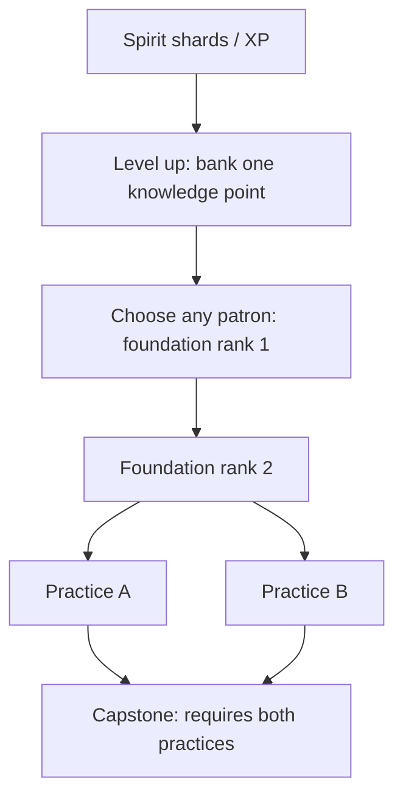

# Patron tech tree

The implemented roster contains **eight patrons, 32 technologies, and 40 research ranks**. Each patron supports a different way of keeping the Blue Banner clan alive. Their abilities are original game mechanics; the narrative context and historical sources are in [lore.md](../lore.md#patron-traditions).

## Research rules

Collectible spirit shards grant XP. Each level banks one knowledge point without interrupting combat. Open the paused **Patron tech tree** with **T**, controller **LB**, the HUD, Pause, or the chronicle. Every rank costs one knowledge point. Stored **Spirit** remains a separate currency for camp construction.

Every patron begins with a two-rank foundation. Both practices require foundation rank 2. The capstone requires both practices. Completing a patron costs five points; there are no mutually exclusive patrons or practices. Invest across patrons freely, keep points unspent, and research during crossings. All research resets with a new expedition.

Each step costs one point. Practice order is free. Percentages multiply unless explicitly stated otherwise. Distances below are world units, called paces in the interface; all timers use active gameplay seconds.

## Börte Chino · aggressive hunting

Keep momentum, hunt wounded targets, and recover health through kills. This path rewards sustained movement rather than stationary defense.

| Tier                | Technology / stable ID                       | Effect                                                                                        |
| ------------------- | -------------------------------------------- | --------------------------------------------------------------------------------------------- |
| Foundation, 2 ranks | **The wolf’s trail** · `wolf-trail`          | Each rank: friendly damage ×1.15 while momentum is above 0.5; ordinary commander speed ×1.04. |
| Practice A          | **The culling bite** · `culling-bite`        | Friendly damage ×1.3 against targets already below half maximum health.                       |
| Practice B          | **Never lose the quarry** · `pursuit-gallop` | Gallop cooldown ×0.75: 3 → 2.25 seconds.                                                      |
| Capstone            | **Blood of the hunt** · `blood-of-the-hunt`  | Each enemy kill above 0.5 momentum restores 2 commander health, capped at maximum health.     |

At full investment, moving damage is ×1.3225, rising to ×1.71925 against wounded enemies before other bonuses. Ordinary speed becomes 205.504 from 190. Fixed gallop speed and duration stay 570 and 0.3 seconds. Conditional damage applies through the shared friendly-damage pipeline, including support attacks; kill recovery does not require the commander to land the final arrow.

## Etügen Eke · sustainable civilisation

Stretch the camp's useful lifetime, gather construction supplies, and feed more households. This path has no direct attack bonus.

| Tier                | Technology / stable ID                        | Effect                                                                                                               |
| ------------------- | --------------------------------------------- | -------------------------------------------------------------------------------------------------------------------- |
| Foundation, 2 ranks | **Tend the living ground** · `tended-pasture` | Each rank: stationary food production ×1.15 and pasture depletion ×0.85.                                             |
| Practice A          | **Many hands, one camp** · `shared-labour`    | Stationary material production ×1.25.                                                                                |
| Practice B          | **Take only what we need** · `measured-herds` | Food consumption ×0.8, including during migration; stacks with Winter stores.                                        |
| Capstone            | **The earth remembers care** · `living-earth` | Recover 0.12 pasture percentage points/second while stationary, offsetting depletion. Pasture remains within 0–100%. |

Two foundation ranks give ×1.3225 food production and ×0.7225 pasture depletion. With the capstone, net pasture loss is about 0.22405 percentage points/second instead of 0.47619: roughly 446 seconds from full pasture to zero. The capstone slows exhaustion; it does not make stationary pasture inexhaustible. Food/material gathering and pasture recovery stop during migration. Research does not create workers or remove building worker requirements.

## Khükhedei Mergen · ranged combat

Increase the shared damage stat, extend the mounted host's targeting reach, and send arrows through multiple enemies.

| Tier                | Technology / stable ID                        | Effect                                                                                                            |
| ------------------- | --------------------------------------------- | ----------------------------------------------------------------------------------------------------------------- |
| Foundation, 2 ranks | **The measured bow** · `power`                | Each rank: shared damage ×1.25; commander and accompanying-rider targeting range +30.                             |
| Practice A          | **An unbroken volley** · `haste`              | Mounted-host firing interval ×0.85.                                                                               |
| Practice B          | **One shaft, two shadows** · `piercing-shaft` | Friendly arrows can hit one additional enemy. Each projectile hits a given pooled enemy incarnation at most once. |
| Capstone            | **A sky full of arrows** · `sky-volley`       | +2 commander arrows per volley. Does not recruit riders or add arrows to every companion.                         |

Full investment gives shared damage 25 from 16, host interval 0.51 seconds from 0.6, three commander arrows, commander targeting range 500–620 with momentum, and accompanying-rider targeting range 500. Shared damage also strengthens lightning, burns, wards, ancestral arrows, and wedge damage. Wagon, sanctuary, terrain-pulse, and ancestral timers are independent of host haste. Arrows retain their fixed speed and lifetime; more targeting range does not extend flight time. Piercing applies to friendly projectiles, including ancestral and wagon arrows.

## Golomt · survival

Carry the hearth through the expedition: increase health, recover between hits, and survive one lethal blow.

| Tier                | Technology / stable ID                      | Effect                                                                                                                         |
| ------------------- | ------------------------------------------- | ------------------------------------------------------------------------------------------------------------------------------ |
| Foundation, 2 ranks | **Keep the hearth alive** · `vitality`      | Each rank: +20 maximum commander health; immediately heal 35, capped at the new maximum.                                       |
| Practice A          | **The carried embers** · `carried-embers`   | Regenerate 0.3 commander health/second during active play.                                                                     |
| Practice B          | **Felt around the flame** · `felt-and-fire` | Commander damage taken ×0.85.                                                                                                  |
| Capstone            | **The last ember** · `last-ember`           | The next lethal commander hit restores 40% maximum health instead of ending the expedition. Consumed once for this expedition. |

Full investment gives maximum health 140 and revival health 56. Regeneration and the revival do not restore population or clan resolve. Losing the clan still ends the expedition. The revival charge cannot be repurchased after use: its technology remains learned. Normal hit invulnerability still applies. Recovery timers freeze in every menu.

## Lus · terrain manipulation

Control approaches around both commander and caravan, anticipate eruptions, and push the horde out of the commander's field.

| Tier                | Technology / stable ID                          | Effect                                                                                                                           |
| ------------------- | ----------------------------------------------- | -------------------------------------------------------------------------------------------------------------------------------- |
| Foundation, 2 ranks | **Find the watercourse** · `watercourse`        | Each rank adds 12 percentage points of enemy movement reduction within 165 units of commander or camp.                           |
| Practice A          | **Shelter among the reeds** · `reed-beds`       | Field radius +65, reaching 230.                                                                                                  |
| Practice B          | **Read the shifting ground** · `turned-earth`   | Eruption warnings +1 second; eruption damage to commander and clan ×0.5.                                                         |
| Capstone            | **The returning current** · `returning-current` | Every 4 seconds, enemies in the commander's field take shared damage ×0.75 and are pushed 80 units outward, within world bounds. |

Two foundation ranks slow enemies by 24%; overlapping commander/camp fields do not double it. Slowing affects enemy movement, including bosses, rather than projectile speed or spawning. The damaging pulse belongs to the commander field; camp has a slowing field but no separate water pulse. Eruption mitigation stacks with commander and clan protection. It does not protect against ordinary attacks or hostile arrows. These moving fields do not edit the map or create impassable terrain.

## Ongod · spiritual summoning

Ride with visible ancestral echoes while improving shard collection and stored Spirit income.

| Tier                | Technology / stable ID                                 | Effect                                                                                                                             |
| ------------------- | ------------------------------------------------------ | ---------------------------------------------------------------------------------------------------------------------------------- |
| Foundation, 2 ranks | **A rider remembered** · `ancestral-companion`         | Each rank summons one echo following the commander. Echoes shoot at 55% shared damage every 1.1 seconds, with targeting range 360. |
| Practice A          | **Hands remember the bow** · `remembered-aim`          | Echo arrow multiplier rises from 0.55 to 0.9.                                                                                      |
| Practice B          | **Follow the spirit thread** · `spirit-thread`         | Shard attraction radius ×1.4; stored Spirit earned on kills ×1.25. Does not increase dropped XP.                                   |
| Capstone            | **The council rides with us** · `council-of-ancestors` | Summon a third echo; ancestral firing interval ×0.7, reaching 0.77 seconds.                                                        |

Echoes are separate from the ordinary rider count, with a hard maximum of three. They do not reserve workers, consume horses, take damage, or provide physical shields. Their arrows use the existing bounded projectile pool and benefit from friendly projectile effects. They retain the shared rider animation frames, ground anchors, active-time movement, and menu freeze behavior. Full investment gives attraction radius 119 from 85 and kill Spirit `enemy XP ×0.5` instead of ×0.4. Route/story Spirit rewards are unaffected.

## Sülde · army leadership

Recruit the living host, strengthen its arrows, accelerate crossings, and restore clan morale through victories.

| Tier                | Technology / stable ID                          | Effect                                                                              |
| ------------------- | ----------------------------------------------- | ----------------------------------------------------------------------------------- |
| Foundation, 2 ranks | **Riders of one standard** · `sworn-riders`     | Each rank recruits one accompanying rider.                                          |
| Practice A          | **Rally to the blue cloth** · `rallying-banner` | Accompanying-rider arrow damage ×1.25.                                              |
| Practice B          | **No wagon left behind** · `ordered-march`      | Migration mobility ×1.15, stacking with horses and Remount herds.                   |
| Capstone            | **The unbroken standard** · `unbroken-standard` | +2 accompanying riders; every enemy kill restores 0.15 clan resolve, capped at 100. |

Full investment adds four living riders: five with the starting companion, before buildings/rescues and the shared 16-rider cap. Rider damage multipliers become 0.75 normally or 1.125 with Veteran riders, before other bonuses. Commander projectile count and ancestral echoes remain separate. Resolve recovery does not resurrect casualties.

## Guardian of Burkhan Khaldun · defensive construction

The clan's imagined mountain guardian inspires cheaper portable defenses, camp protection, and a ward that follows the caravan.

| Tier                | Technology / stable ID                               | Effect                                                                                                                           |
| ------------------- | ---------------------------------------------------- | -------------------------------------------------------------------------------------------------------------------------------- |
| Foundation, 2 ranks | **Foundations we can carry** · `caravan-foundations` | Each rank: camp material prices ×0.9 and clan damage taken ×0.9.                                                                 |
| Practice A          | **Watchfires on the ridge** · `watchfires`           | Wagon circle firing interval ×0.75: 0.9 → 0.675 seconds. A constructed Wagon circle is required to fire.                         |
| Practice B          | **A circle of sheltered ground** · `stone-shelter`   | Camp ward deals shared damage ×0.65 within radius 125 every 2 seconds, including during migration. Does not require a sanctuary. |
| Capstone            | **Hold the passage** · `hold-the-passage`            | Clan damage taken ×0.8 again, stacking with camp defenses and formation.                                                         |

Two foundation ranks give a material price multiplier of 0.81. Apply it to the normal individual purchase price and round up; Archery grounds therefore cost `ceil(24 ×0.81) = 20` materials. Spirit and worker requirements are unchanged. Discounts cover both establishment and developments; they do not refund earlier purchases. At full investment, this patron's clan protection multiplier is 0.648. With Caravan guard, Felt armor, and Ancestral ward, the clan takes 18.144% of raw damage. Commander health is protected separately through Golomt and eruption mitigation. The mountain ward and sanctuary ward can both operate with independent timers.

## Interface and extension points

The tree shows one card per technology with its rank progress, foundation/practice/capstone role, effects, cost, prerequisites, and learned/available/locked state. The foundations remain actionable until both ranks are learned. Cards lay out by prerequisite depth; filters and accent-insensitive search work across all patrons. Purchases preserve focus and scroll. The camp upgrade tree uses the same renderer, its own content adapter, and the same scalable category/search controls.

Add patron metadata in [data/patrons.ts](../src/game/data/patrons.ts), technologies in [data/upgrades.ts](../src/game/data/upgrades.ts), and balance constants in [config.ts](../src/game/config.ts). Layout derives from this data, with no fixed eight-slot markup or authored coordinates. New technologies can introduce additional siblings and deeper tiers. See [the extension guide](progression-ui.md) for the typed content contract and camp development examples.

Neutral modifiers and pure gameplay rules live in [state/patrons.ts](../src/game/state/patrons.ts); [state/clan.ts](../src/game/state/clan.ts) applies economy, construction, protection, leadership, and travel modifiers. [PatronSupport](../src/game/systems/PatronSupport.ts) handles the bounded ancestral riders, quiet ground fields, pulse, and mountain ward using active seconds. [ArenaScene](../src/game/scenes/ArenaScene.ts) remains the authority for simulation, attacks, damage, pooling, and menu transitions.

After all 40 ranks are mastered, further knowledge points convert to 20 food and 15 materials each and fully heal the commander. Excess XP remains preserved. A temporarily blocked technology never counts as mastery.
